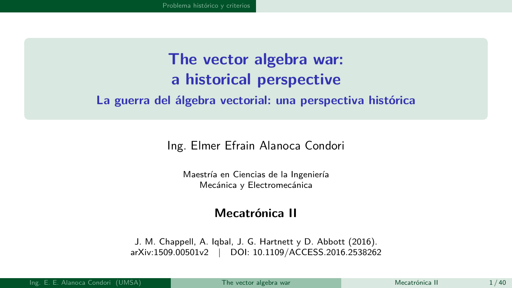

# The vector algebra war: a historical perspective

**Ing. Elmer Efrain Alanoca Condori**  
UMSA  
Maestría en Ciencias de la Ingeniería Mecánica y Electromecánica  
Mecatrónica II

## Entregables

- `presentacion.tex`: fuente autónoma Beamer con el tema nativo EastLansing, 16:9.
- `presentacion.pdf`: 40 diapositivas principales y 22 apéndices técnicos.
- `guion_docente.md`: notas académicas por diapositiva.
- `revision_contenido_paper.md`: cotejo de contenido, ecuaciones, convenciones y atribuciones.
- `scripts/verificar_algebra.py`: comprobaciones reproducibles.
- `WARaLG.pdf`: manuscrito original, conservado sin cambios.
- `portada.png`: vista previa de la carátula.

## Artículo de referencia

James M. Chappell, Azhar Iqbal, John G. Hartnett y Derek Abbott.
*The vector algebra war: a historical perspective* (2016).
[arXiv:1509.00501v2](https://arxiv.org/abs/1509.00501v2).
[DOI: 10.1109/ACCESS.2016.2538262](https://doi.org/10.1109/ACCESS.2016.2538262).

El artículo original conserva la autoría y los derechos de sus autores.
La presentación, las notas y la revisión distinguen el contenido del artículo
de los desarrollos complementarios.

## Vista previa



## Compilar

```sh
latexmk -pdf -interaction=nonstopmode -halt-on-error -outdir=build presentacion.tex
cp build/presentacion.pdf presentacion.pdf
```

En Overleaf, cargar `presentacion.tex` y compilar con pdfLaTeX.
Los diagramas son TikZ; no requieren imágenes externas.

## Verificar

```sh
python3 scripts/verificar_algebra.py
```

El cuerpo principal sigue el argumento del artículo. Las extensiones propias
se distinguen y se agrupan en los apéndices. La matriz de revisión cubre las
ecuaciones (1)–(27) y las secciones I–V del manuscrito.
